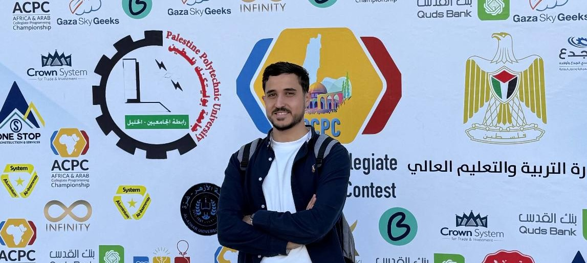

<h1 align="center">Hi 👋, I'm Momen Arman</h1>

<strong>Computer Engineering Student</strong> Interested in artificial intelligence

---

### About Me

I'm studying computer engineering, and I'm especially curious about how computers learn from data.

### Currently Learning

I'm exploring artificial intelligence and cloud computing.

### Featured Project

**[Palestinian Heritage Atlas](https://github.com/momenarman-max/Multi-Database-Design-for-a-Heritage-Tourism-Platform)**

A tourism platform for exploring Palestinian heritage sites, booking tours with local guides, and finding guesthouses. Each site page brings together data from PostgreSQL, MongoDB, and Neo4j. Redis caches the result for the next visitor.

### Connect With Me

[Connect with me on LinkedIn](https://www.linkedin.com/in/momen-arman-23a203389/)
